<a href="https://shreyaswani.vercel.app/">
  
</a>

  
  
  

  <a href="https://github.com/shreyas0917/marketpulse">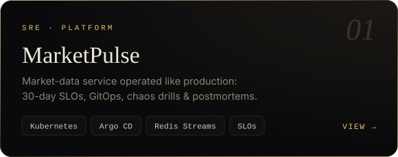</a>
  <a href="https://github.com/shreyas0917/seatlock"></a>
  <a href="https://github.com/shreyas0917/EventGuard">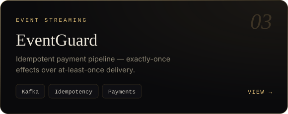</a>
  <a href="https://github.com/shreyas0917/tax-pl-engine">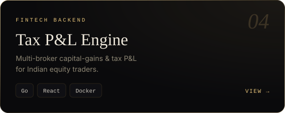</a>
  <a href="https://github.com/shreyas0917/Retrace"></a>
  <a href="https://github.com/shreyas0917/Invoice-3-Way-Match-Public"></a>

Full case studies → <a href="https://shreyaswani.vercel.app/"><b>shreyaswani.vercel.app</b></a>

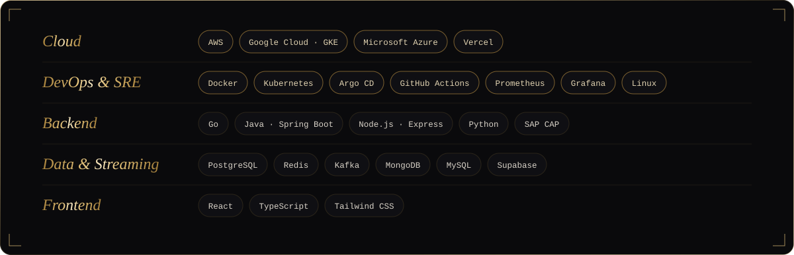


