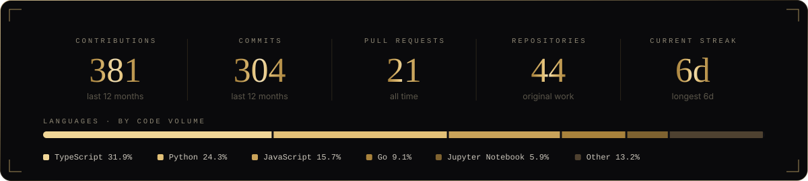
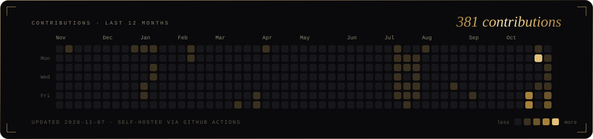

  
  
  

 

  

<table>
  <tr>
    <td width="50%"></td>
    <td width="50%"></td>
  </tr>
  <tr>
    <td width="50%"></td>
    <td width="50%"></td>
  </tr>
  <tr>
    <td width="50%"></td>
    <td width="50%"></td>
  </tr>
</table>

More on the full portfolio → <a href="https://shreyaswani.vercel.app/"><b>shreyaswani.vercel.app</b></a>

 

  

  

 

  

  

  

 

  

